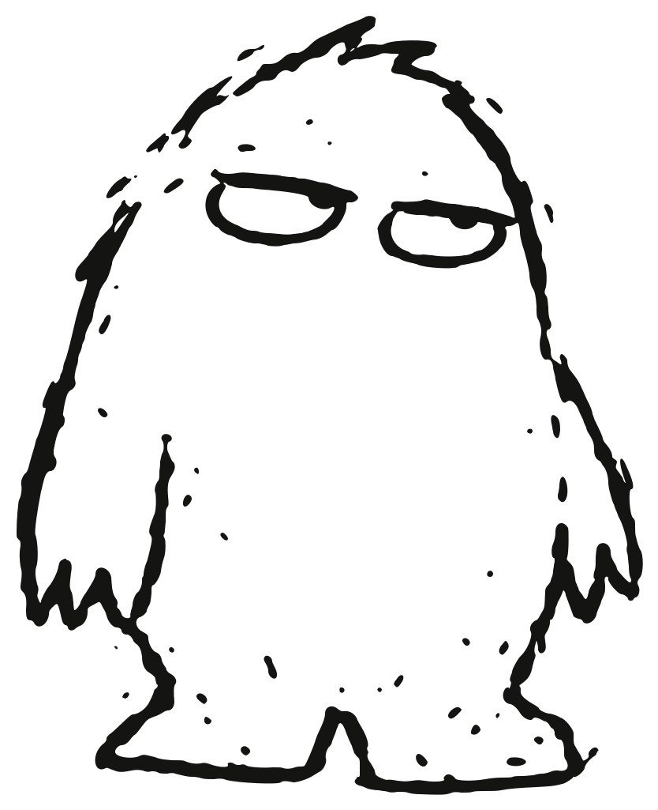

<p align="center">
  
</p>

<h1 align="center">bogyman</h1>

<p align="center">Your agents haunt you. Haunt them back.</p>

Which of your agent sessions needs you, on what, and for how long.

`bogyman` watches the Claude Code and Codex sessions you already started,
wherever you started them, and keeps one list: who is blocked, on what, and
since when. It never spawns, schedules, or attaches to anything. Hooks push
events into a local SQLite file; the CLI reads it.

This is v0.1, the hook MVP from the PRD. It covers the Claude Code hook stream,
the Codex hook / notify stream, and a cheap poll of Claude Code's per-session
status files. Pollers for `claude agents --json`, `focus`, `send`, the daemon
and notifications are later milestones.

## Install

```sh
cargo install --path crates/bogyman-cli   # puts `bogyman` in ~/.cargo/bin
bogyman install                            # wires Claude Code (+ Codex) hooks
bogyman doctor                             # confirms events arrive
```

`bogyman install` merges handler entries into `~/.claude/settings.json` and
`~/.codex/hooks.json`, writing a `.bogyman-bak` first. Existing hooks are left
alone. A second run is a no-op; `bogyman uninstall` removes only bogyman's
entries. Pass `--dry-run` to preview.

## Commands

| Command | What it does |
| --- | --- |
| `bogyman ls` | Every live session, blocked first. `--all` adds failed and stopped from the last 24 h, `--watch` redraws each second. |
| `bogyman waiting` | Blocked sessions only, oldest wait first. Exit 3 when empty, so it works in `&&` chains. |
| `bogyman status` | One line for prompts: `⏳2 ▶3 ✓1`. Cache only. `--format '{blocked} waiting'` to template. |
| `bogyman show <id>` | Full record plus the last 20 events. `<id>` is a bogyman id, a unique prefix, the vendor id, or the name. |
| `bogyman install` / `uninstall` | Register or remove hooks. `--claude`, `--codex`, `--dry-run`. |
| `bogyman doctor` | Vendor versions, hooks registered, store health, last event per vendor. `--verbose` dumps recent events. |
| `bogyman gc` | Prune events older than `retention_days` (default 7). |
| `bogyman version` | Version, git commit, build date, target. Same line as `--version`. |
| `bogyman hook <vendor>` | Hook entry point, invoked by the vendor. Reads stdin, appends one row, exits 0. |

Every command takes `--json` (schema 1), `--vendor claude|codex`, `--cwd <path>`
and `--no-color`. Human output is a table on a TTY and header-less TSV when piped.

Exit codes: 0 ok, 1 error, 2 bad usage, 3 empty result (`waiting`), 4 vendor
command unavailable.

## Where things live

| Path | Purpose |
| --- | --- |
| `~/.local/share/bogyman/bogyman.db` | Event log and session snapshot (SQLite, WAL). |
| `~/.local/share/bogyman/bogyman.log` | Hook-path errors. Hooks never print. |
| `~/.config/bogyman/config.toml` | Optional. See below. |

`BOGYMAN_HOME` puts everything under one directory. `CLAUDE_CONFIG_DIR` and
`CODEX_HOME` are honored the same way the vendors honor them.

```toml
[store]
retention_days = 7
redact = false        # true drops free-text detail (what a session waits on)

[collectors]
claude_sessions = true   # poll ~/.claude/sessions/*.json on each query
```

## Development

```sh
cargo test --workspace
cargo clippy --workspace --all-targets
```

Vendor payload shapes live under `tests/fixtures/<vendor>/<version>/` and are
checked by golden tests, so a vendor format change fails a test rather than a
user. Add a fixture when a vendor adds or changes an event.

Crates: `bogyman-core` (session model, events, reducer), `bogyman-store`
(SQLite), `bogyman-collectors` (vendor parsers), `bogyman-cli` (the binary).
